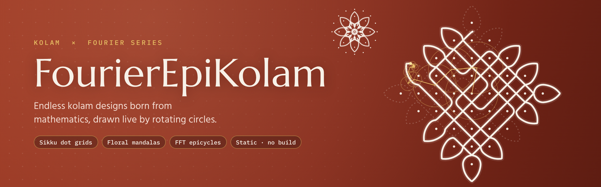
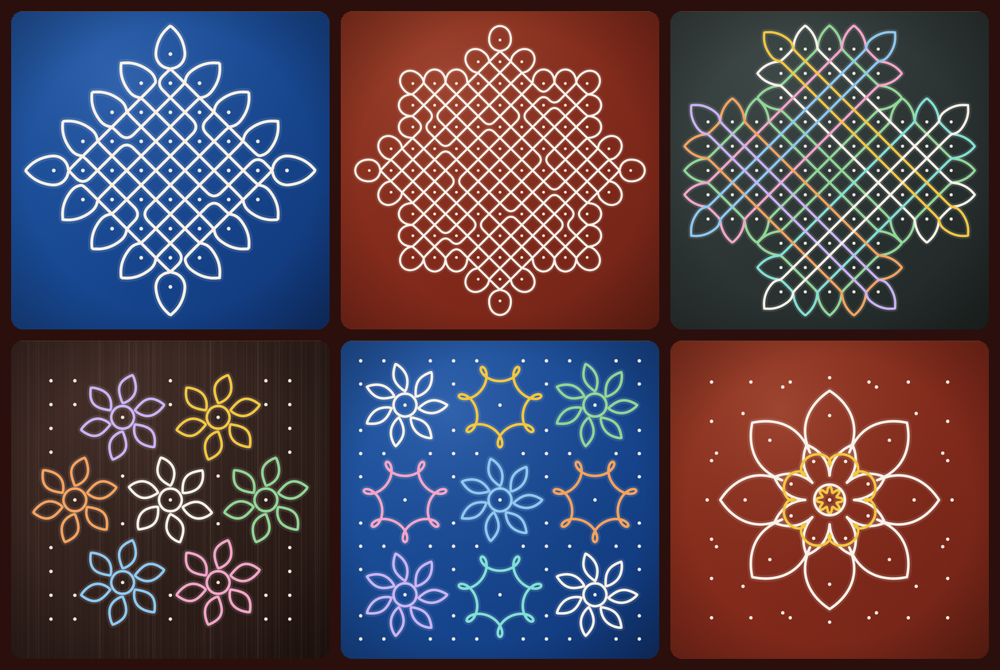

<p align="center">
  
</p>

<p align="center">
  <a href="#run-it-yourself">Run it yourself</a>
  &nbsp;·&nbsp;
  <a href="#how-the-math-works">How the math works</a>
</p>

<p align="center">
  
  
</p>

---

## Watch it draw

Each kolam is redrawn by a chain of rotating circles: the Fourier series of
its line, largest circle first. The two animations below are real epicycle
machines built from the app's own generator code, playing right here in the
README.

<p align="center">
  
  
</p>
<p align="center"><sub>Left: a one-line sikku kolam on a 7–1 diamond, 220 circles. Right: seven spiral-loop flowers, each traced by its own chain of circles.</sub></p>

## A new kolam every time

Press **Draw a new kolam** (or `N`) and the generator makes a design from
scratch. Every one has a design number, so you can bring it back or share it.

<p align="center">
  
</p>

## Features

**Dot-grid kolams (sikku / pulli)**
- Grids: square up to 15×15, diamond up to 19–1, rectangle, star, octagon, cross and ring.
- One unbroken line, or several interlaced lines in different colours.
- Symmetry: 4-fold turn, 4-fold with mirrors, two mirrors, one mirror, or none.
- Weave: open, mixed or a dense net of crossings.
- Outer loops: smooth, round petals, or pointed teardrops.

**Floral kolams**
- Five flower families, each a closed mathematical curve: lotus, rose, spiral loops, star loops and leaf petals.
- Layouts: single mandala, seven flowers, 3×3 garden, or a ring of flowers, with pulli dots in the gaps.

**Drawing, saving and sharing**
- Choose how many Fourier circles draw the line, from 4 up to all of them. Fewer circles give a soft, dreamy version.
- Draw lines one at a time or all together, at ten speeds.
- Floors: red oxide, indigo, dark wood or slate.
- Save as PNG (2400 px) or SVG, copy a link to the exact design, and go full screen (`F`).

## Run it yourself

No install and no build step. Open `index.html`, or serve the folder:

```bash
npx serve .
# or
python3 -m http.server 8000
```

## How the math works

### 1. One unbroken line from a tree

The line runs diagonally between the dots and passes through the gap between
every pair of neighbouring dots. At each gap it can **cross** the other strand,
**bounce** back, or **slip** through to the next dot, and the outer border
always bounces.

With no crossings, the whole drawing is a **single closed line exactly when the
slip-through gaps form a spanning tree of the dots**. The generator grows a
random spanning tree that respects the chosen symmetry, then adds crossings one
at a time, keeping each only if the line stays unbroken.

Symmetry has limits. Mirror lines through the dots always split the drawing,
and a 4-fold or half-turn design on an even grid needs at least two lines. The
app explains this when it happens, and **Auto** symmetry picks one that keeps a
single line.

### 2. Flowers from curves

Each flower is a closed parametric curve. Rose petals and the looping
spiral flowers, for example:

$$r(\theta) = b + (1-b)\,\lvert\cos(n\theta/2)\rvert^{q} \qquad\qquad z(\theta) = e^{i\theta} - B\,e^{i(n+1)\theta}$$

The spiral flower is already a sum of two rotating circles, which is why
it needs so few epicycles in the animation above.

### 3. Fourier epicycles

Every closed line is resampled evenly into complex points $z_0, \dots, z_{M-1}$
and transformed with an FFT:

$$c_k = \frac{1}{M}\sum_{m=0}^{M-1} z_m\, e^{-2\pi i k m / M}, \qquad z(t) = \sum_k c_k\, e^{2\pi i f_k t}$$

Each term is one circle of radius $|c_k|$ spinning at frequency $f_k$. Sorted by
size and chained tip to tip, the circles trace the kolam as $t$ runs from 0 to 1.
Keeping only the largest $K$ circles gives a smooth approximation.

### Design numbers

All randomness comes from a seeded generator. The same design number with the
same settings always rebuilds the same kolam, and **Copy link** stores both in the URL.

## Project layout

```
index.html               page and controls
assets/style.css         styles
assets/favicon.svg       icon
assets/readme/           banner, gallery and animated README drawings
js/fourier.js            smoothing, resampling, FFT, epicycles, seeded random numbers
js/sikku.js              dot-grid kolam generator
js/floral.js             floral kolam generator
js/app.js                interface, animation, PNG/SVG export, share links
scripts/readme-art.js    rebuilds the animated SVGs: node scripts/readme-art.js
vercel.json              static hosting settings
```

## Credits

- Kolam is a living South Indian tradition, drawn each morning at the threshold in rice flour.
